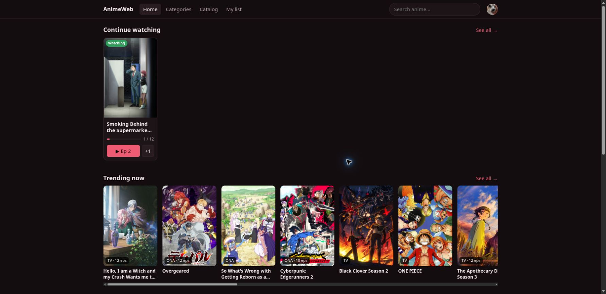
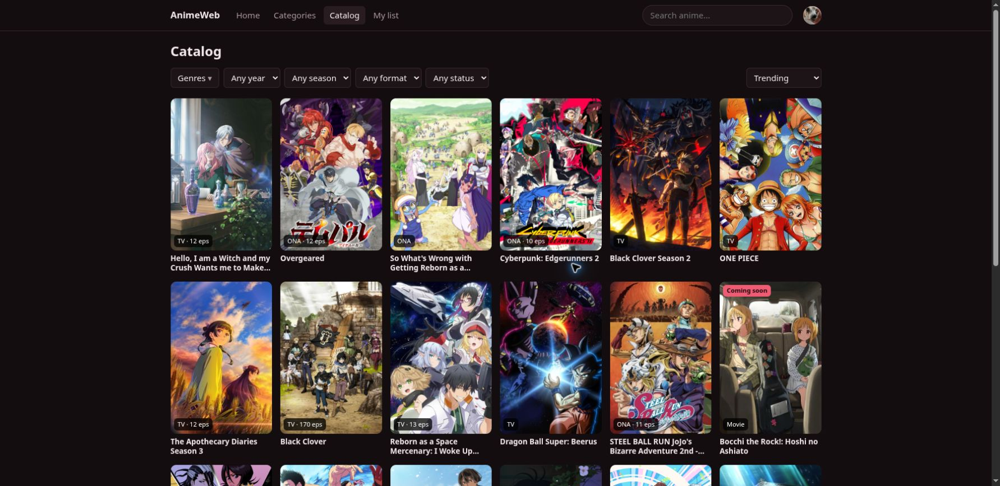
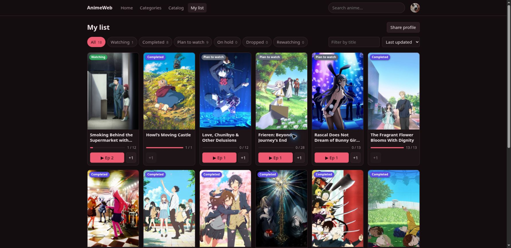

# AniTether

**A self-hosted anime list, catalog, and launcher.** Keep track of what you watch — status,
episode progress, score, and notes — then open the next episode on a streaming site you
configured yourself, or watch it in AniTether's own embedded player page.

AniTether ships with no sources. The "streaming sites" are URL templates an admin adds in the
admin UI (name, base URL, search / episode / embed patterns). The app then builds ▶ buttons
and an embedded watch page from those templates. Think of it the way an emulator doesn't come
with games: the tool is legal and content-free, and you point it at whatever you own the
right to use.

[Live example](https://froymain.tail144dc9.ts.net/)

## Screenshots

Home, with continue-watching and trending:



Browse and filter the whole AniList catalog:



Status, episode progress, and score at a glance:



## What you can do

- Track status, episode progress, score, and notes for each anime.
- Browse and search the AniList catalog by genre, year, season, format, and airing status.
- Import a list from AniList or a MyAnimeList XML export.
- Add admin-managed source templates and save per-anime links.
- Share an opt-in, read-only profile by link; accounts are invite-only.
- Choose from three themes, each with dark, light, or system color mode.
- Optionally connect Plex for scrobbling (later-phase feature).

## Streaming sources

A source is one template an admin adds under **Sources (admin)**:

- **Base URL** — the site's home, such as `https://example.com`.
- **Search pattern** — its search page with `{title}`.
- **Episode pattern** — an episode URL with `{episode}` and an identifier such as
  `{anilist_id}`, `{mal_id}`, or `{slug}`.
- **Embed pattern** (optional) — an embed URL for the watch page.

For sites that need an anime-specific slug, save the link once (search the site or paste its
URL) and every user gets the ▶ button. See the
[admin guide](docs/admin-guide.md#streaming-sources).

## Documentation

| I want to… | Read |
|---|---|
| Use AniTether | [User guide](docs/user-guide.md) |
| Manage users and sources | [Admin guide](docs/admin-guide.md) |
| Run it on my own server | [Self-hosting guide](docs/self-hosting.md) |
| Maintain, back up, and update it | [Maintenance](docs/maintenance.md) |
| Troubleshoot a problem | [Troubleshooting](docs/troubleshooting.md) |
| Work on the code | [Development guide](docs/development.md) |

## Quick start (development)

Needs Docker, the .NET 10 SDK, and Node.js 20+.

```bash
docker compose up -d db
dotnet restore && npm --prefix web ci
ConnectionStrings__Default='Host=localhost;Port=5432;Database=anitether;Username=anitether;Password=anitether' \
  dotnet ef database update --project api
ConnectionStrings__Default='Host=localhost;Port=5432;Database=anitether;Username=anitether;Password=anitether' \
  Bootstrap__AdminEmail=you@example.com Bootstrap__AdminPassword='Change-me-1' \
  dotnet run --project api          # API on http://localhost:5000
npm --prefix web run dev            # site on http://localhost:5173
```

Log in at <http://localhost:5173> with the email and password you set above. More detail is in
the [development guide](docs/development.md).

## Self-hosting

Production installs run as a Docker Compose stack with PostgreSQL, a one-shot migrator, the
API, a daily backup, and an optional Cloudflare Tunnel. See
[docs/self-hosting.md](docs/self-hosting.md).

## License

[GPLv3](LICENSE) — free to use, modify, and redistribute under the same terms.
